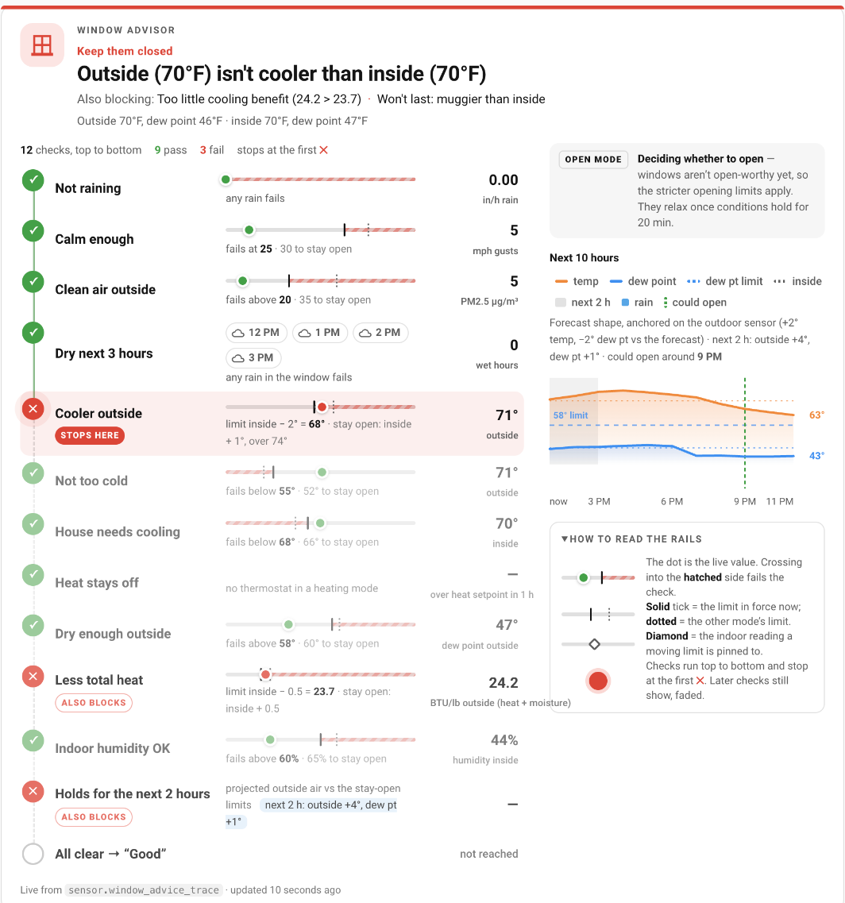

# Home Assistant Blueprints

Custom blueprints with automatic sync workflow for rapid development.

Device-specific quirks (weird entities, HomeKit fixes, etc.) are tracked in [HARDWARE-NOTES.md](HARDWARE-NOTES.md).

## Quick Start

```bash
# 1. Install dependencies
./install-deps.sh

# 2. Configure environment
cp .env.example .env
nano .env  # Add HA path, URL, and token

# 3. Mount HA SMB share
# macOS: Finder → Go → Connect to Server → smb://homeassistant.local

# 4. Start auto-sync
./watch.sh
```

## Blueprints

### Motion & Lighting
- **motion-light-controller.yaml** - Motion lights v2: manual respect via tracking helper, time-of-day-sensor timeouts (day/night off-delays), optional scene turn-on, reconcile watchdog. Requires HA 2024.10+ and a per-room input_boolean
- **motion-light-simple.yaml** - Simple motion-activated lights with scenes, overrides, and manual control cancellation
- **motion-and-door-light-control.yaml** - Advanced motion + door sensors with late-night modes
- **motion-auto-off-lights-with-override.yaml** - Basic motion with manual override

### Climate Control
- **bathroom-controller.yaml** - Combined bathroom automation: humidity fan (threshold/reference/derivative modes, purge, min/max runtimes), motion lights with shower hold (optional scene turn-on, day/night off-delays from a time-of-day sensor or a clock window), optional shower start/cancel button events (e.g. fan-paddle double-taps), optional heater with restart-surviving safety cutoff. Requires HA 2024.10+ and per-bathroom tracking helpers (see the blueprint description)
- **steamer-controller.yaml** - Garment steamer (or any heating appliance) on a metered smart plug, the appliance's own switch stays the control: exhaust fan on when it draws power (off after a humidity settle - absolute threshold and/or offset from a reference sensor, like bathroom-controller - or a fixed purge, min/max runtimes, manual respect), plug cut after N minutes without motion or past a max runtime, per-event announcements (persistent, mobile notify, TTS), and automatic re-enable - on the next room entry the plug is probed back on; if the appliance still draws power (switch left on) it is cut again and you are told, otherwise it stays on. Manual plug-on / the plug's own button also re-enables. Requires HA 2025.4+ and three input_booleans (running, plug-cut, fan tracking)
- **window-advisor.yaml** - Window Advisor (template blueprint): one sensor that says when opening the windows will cool the house without letting in humidity, rain, smoke or wind, and when to close them. Forward-looking (2-hour outlook from an hourly forecast, anchored on your own outdoor sensor), weighs heat and moisture together (enthalpy), and with thermostats it says "crack them" on cool nights and only "close" when the heat is about to come on. Debounced, with hazard and forgotten-window flags. Requires HA 2026.10+. See [Window Advisor](#window-advisor)
- **window-advisor-notify.yaml** - Phone pushes for the Window Advisor: good time to open (with an "I opened them" button), time to close, close-now hazards, forgotten-window alarm, can't-see-the-weather, arming away with windows open. Needs one Text helper. Requires HA 2026.10+
- **temperature-fan-control.yaml** - Temperature-based fan control with multiple speed levels
- **air-quality-fan.yaml** - Air quality fans (CO2, PM2.5, TVOC sensors)

### Remotes & Controls
- **zooz-zen37-remote-control.yaml** - Zooz ZEN37 800LR 4-button remote (all press types)
- **aeotec-minimote-controller.yaml** - Aeotec / AEON Labs Minimote (DSA03XXX-ZW, white or black) on Z-Wave JS: Press + Hold per button (Release too on Central Scene firmware), decodes both the Scene Activation (sceneId 1-8) and Central Scene formats, parallel mode. One instance per remote; give twins (e.g. a pair of bedside remotes) identical actions. Works as a media remote too (e.g. Hue Sync toggle/mode, media lighting scenes)
- **aqara-cube-controller.yaml** - Aqara Cube (T1 Pro / older cube on ZHA): one action list per gesture (shake, tap, slide, flip 90/180, rotate left/right, throw) plus "faces as modes": collapsed per-face sections (tap/slide/rotate/flip per face) with an optional Input Number face helper so rotate knows the face, and built-in rotate-to-dim / rotate-to-cycle-scenes that can be limited to one face. Cube must be in Action mode. Requires HA 2024.10+
- **wall-dimmer-natural-light-controller.yaml** - In-wall Z-Wave dimmer as a room controller: paddle drives its own load (recessed cans) at a time-of-day brightness while the room's Hue Natural Light scene handles the smart bulbs. Up 2x = Full Bright, Down 2x = Lamps Only. Optional single-tap prestage (writes the band level into the switch so it turns on at the right level itself), an optional relay/third-button section for switches like the ZEN30, and optional zone-scene sync so the cans join a house-wide Natural Light recall. Requires HA 2026.1+ (for the `scene.activated` trigger) and Scene Control enabled on the switch. Optional GE / Jasco paddle mode for dimmers without Central Scene (14294 / ZW3005): double taps come from the Scene Activation event, single taps from a hand-made load change (no user/parent context), with a settle delay so a double tap's own load report is not mistaken for a single tap. Optional Linked Overheads: other loads that follow every gesture so two dimmers in one room act as one circuit (each instance lists the other's load; zone sync stays per-load)

## Window Advisor

Two blueprints: `window-advisor.yaml` (the sensor) and `window-advisor-notify.yaml`
(the pushes). The advisor's sensor state is the advice: `Good`, `Crack them: …`,
the first thing blocking it (e.g. `Too humid outside (dew point 63°F)`), or
`Blind: …` when a sensor or the forecast is missing (it never guesses).

**Checks, in order:** raining · gusts · PM2.5 · rain in the next hours · outside
not cooler than inside · too cold outside · house already cool · heat about to
kick in · outdoor dew point · total heat (enthalpy) · indoor humidity · holds for
the next 2 hours. Opening uses stricter limits than staying open; it switches to
the looser "stay" limits after 20 min of good, back after 10 min of bad.

**Install**

1. Copy `window-advisor.yaml` to `config/blueprints/template/GeneralAntilles/`
   and `window-advisor-notify.yaml` to `config/blueprints/automation/GeneralAntilles/`.
2. Template blueprints are set up in YAML, under `template:` in configuration.yaml:

   ```yaml
   template:
     - use_blueprint:
         path: GeneralAntilles/window-advisor.yaml
         input:
           outdoor_temperature: sensor.outdoor_temperature
           outdoor_humidity: sensor.outdoor_humidity      # or outdoor_dew_point
           indoor_temperature: sensor.indoor_temperature
           indoor_humidity: sensor.indoor_humidity        # or indoor_dew_point
           weather: weather.forecast_home                 # needs an hourly forecast
           # Optional: rain_rate, rained_recently, wind_gust, pm25 (lists),
           # thermostats (+ thermostat_temperatures), units: C, thresholds.
       unique_id: window_advisor
       name: Window Advisor Trace
   ```

   Thresholds left out use the defaults listed in each input's description.
3. The sensor's attributes are large (~6 KB, every minute). Keep them out of the
   recorder, e.g. `recorder: exclude: entity_globs: [sensor.*_trace]` (hence the
   name above).
4. Create a Text helper (max length 255) and an Input Boolean "Windows open",
   then add an automation from the Window Advisor Notifications blueprint.

**Thermostats** (optional): with them, cold outside means "crack them" instead of
"close", and the close advice comes when a thermostat in a heating mode is
projected to reach its heat setpoint within the hour, at the rate the house is
actually cooling (a least-squares fit over the last 90 min). If your climate
entities round to whole degrees, add each thermostat's finer temperature sensor
in the same order.

**Forecast sensor** (optional, instead of a weather entity): any sensor with an
`hours` attribute holding up to 12 hourly entries `{t, temp, dp, precip}` (ISO
time with offset, °F, °F, precipitation for the hour starting at `t`, or null)
and a `fetched_at` timestamp. [`climate/window-forecast-nbm.yaml`](climate/window-forecast-nbm.yaml)
and the `window_forecast` sensor in
[`climate/window-advisor-templates.yaml`](climate/window-advisor-templates.yaml)
build one from NOAA's National Blend of Models (US only, free, no key), which
tracks a backyard station far better than the default met.no forecast.

**Logic card:** [`logic-view/logic-trace-card.js`](logic-view/logic-trace-card.js)
draws the advisor's `trace` attribute as a ladder (every check, its live value and
both limits, which one decided) with the next 12 hours' projection.



**Tests:** `climate/window_advisor.jinja` is the source of the decision; it is
copied into the blueprint by `climate/build-window-advisor.py` (`--check` in the
tests). `logic-view/test-window-advisor-v2.py`, `test-window-advisor-blueprint.py`
and `test-window-advisor-notify.py` render everything in a live Home Assistant.

## Controller Guide

`controller-guide/` builds a "what does this button do?" website and
printable sheets for every remote and switch, straight from the live
blueprint instances. See [controller-guide/README.md](controller-guide/README.md).

## Development Workflow

**Auto-sync mode (recommended):**
```bash
./watch.sh
```
Watches files → Validates YAML → Syncs to HA → Reloads automations

**Manual sync:**
```bash
./sync.sh
```

## Features

- ✅ YAML validation before sync
- ✅ Auto-sync on save
- ✅ API-based reload (no HA restarts)
- ✅ Instant error feedback
- ✅ Git version control
- ✅ Fast iteration (seconds from edit to test)

## Automation Organization

All automations use consistent naming: `[Category]: [Area] - [Action]`

**Categories:**
- `Motion:` - Motion-activated lighting
- `Remote:` - Button/remote controls
- `Climate:` - Fans, temperature, humidity
- `Door:` - Door-activated lights
- `Lighting:` - Manual lighting controls
- `System:` - Backups, counters, notifications
- `Security:` - Alarms, sensors
- `Mode:` - Home/away modes

## Useful Scripts

- **house_mode_toggle** - Toggle party/normal mode with voice announcement
- **outdoor_all_on/off** - Control all outdoor lights
- **christmas_lights_on/off** - Seasonal lighting

## Requirements

- Home Assistant with SMB share enabled
- Python 3 + pip
- macOS with Homebrew (for fswatch)
- Network access to HA

See [SETUP.md](SETUP.md) for detailed instructions.
